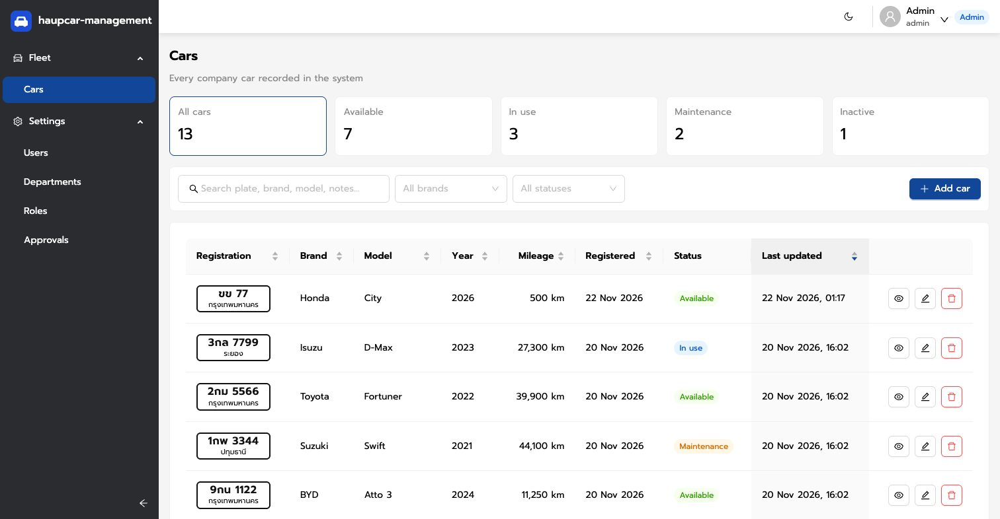
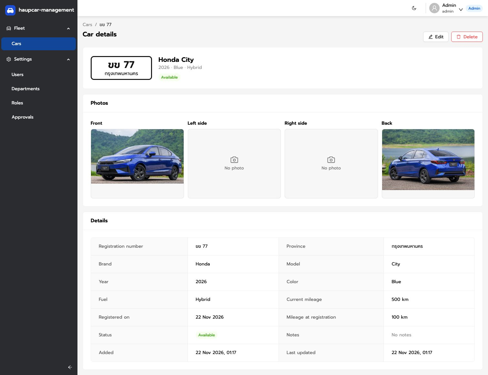
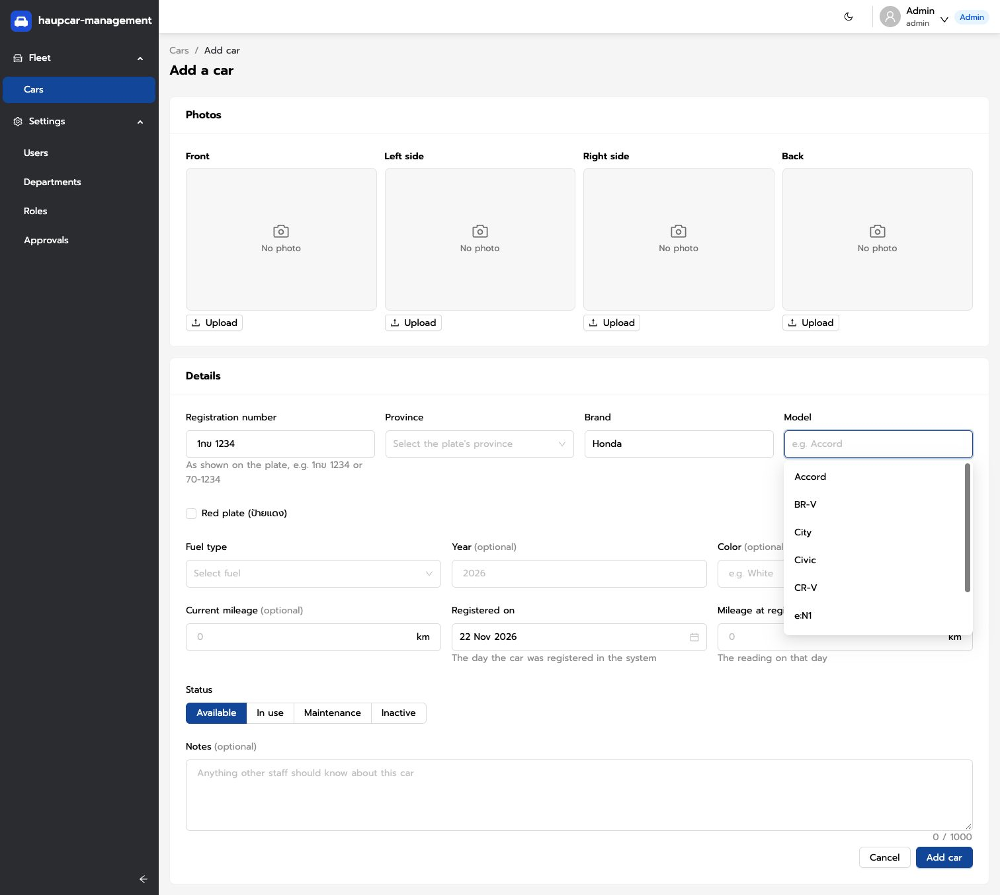
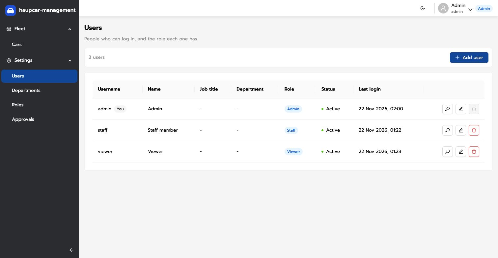
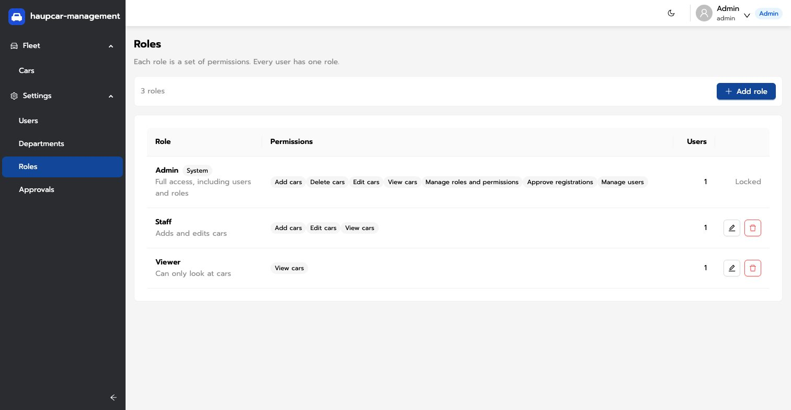
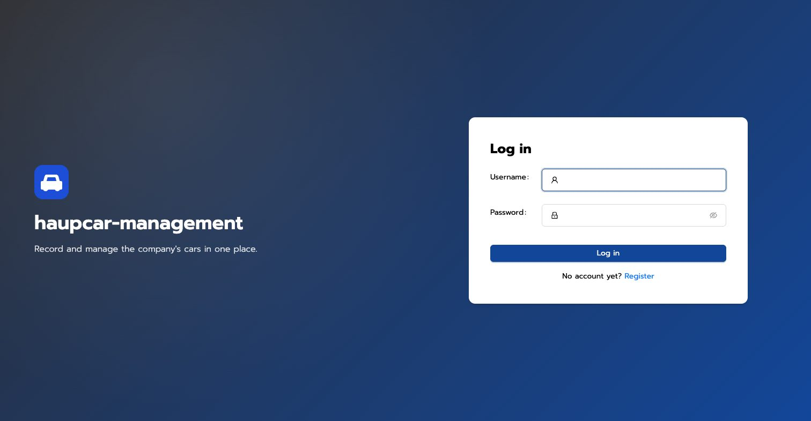
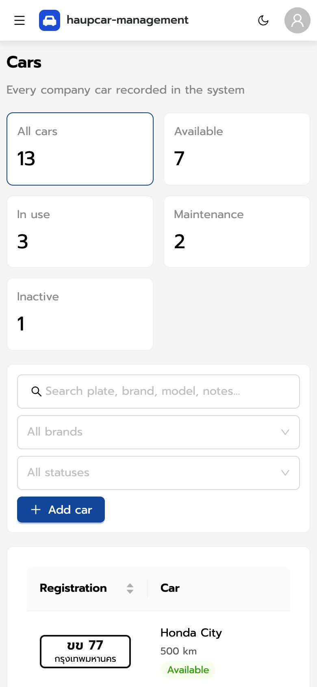

# haupcar-management

A web app for recording the company's car information. It replaces the paper notebook with one shared system where staff can add, view, edit and delete cars.

Built for the Haupcar Full-Stack Developer take-home test. This repository is the web app. It gets its data from the REST API in [haupcar-car-management-test-back-end](https://github.com/Totoland1101/haupcar-car-management-test-back-end), which has to be running.



## Features

### Required

- Add a car with registration number, province, brand, model, fuel type, year, color, current mileage, registration date, mileage at registration, status and notes
- View all cars in a table
- Edit a car
- Delete a car, after a confirmation step

### Login and roles

- Every page except `/login` and `/register` needs a logged-in user. Opening a page while logged out goes to the login page, then back to that page after logging in.
- Each user has one role, and each role is a set of permissions. The UI hides buttons and pages the role doesn't allow, and the API checks the same permissions on every request.
- The Users page adds users, gives them a role, edits their profile, and disables or deletes accounts. A key button on each row sets a new password for that account.
- Everyone has a profile with first and last name, email, phone, job title and department. People edit their own on the My profile page (`/profile`), where a Change password button asks for the current password first. Only an admin can change their role.
- The Departments page adds, renames and deletes departments. Deleting one leaves its people without a department.
- The Roles page creates roles and sets which permissions each one has.
- Anyone can sign up on the register page. The account can't log in until someone with the `user.approve` permission approves it on the Approvals page and picks its role. Until then, logging in shows a "waiting for approval" message. A rejected registration can still be approved later, and the sidebar shows how many people are waiting.

### Extras

- Search across plate, province, brand, model, color and notes
- Filter by brand and status. The summary cards show how many cars are in each status, and clicking one filters the table.
- Sort by most columns, with paging done by the API
- Filters, sort order and page number stay as they were when you open a car and come back. Clicking Cars in the menu or the logo goes back to the first page. The address bar stays a plain `/`.
- Validation in the form and in the API. The API has the final say, and its errors appear under the matching form field.
- The registration number field checks for a Thai plate as you type, with the same rule as the API: car plates such as `1กข 1234`, and truck and bus plates such as `70-1234`. A checkbox marks a red plate (ป้ายแดง), the temporary plate on a new car.
- Province picker with all 77 provinces. The brand field suggests brands, and once a brand is picked the model field lists that brand's models sold in Thailand. A model that isn't listed can still be typed in.
- Plates are drawn in the style of a Thai licence plate, and red plates are drawn black on red
- Car detail page with photos of the front, left side, right side and back. They can be added on the add page and replaced or removed on the edit page. The detail page only shows them.
- A dark sidebar holds the grouped menu, and a slim header shows the user and their role. Each list has a toolbar card above its table, and the font is Prompt. The app opens in light mode and has a switch for dark mode.
- Every page works on phones, tablets and laptops. The sidebar becomes a burger menu at 768px and below, and folds down to icons below 992px. Tables drop their less important columns on smaller screens, and on a phone the car list shows the plate and a one-cell summary.
- Next.js builds a separate JavaScript bundle per page, so the first visit downloads less

## Tech stack

| Part       | Choice                                         |
| ---------- | ---------------------------------------------- |
| Framework  | Next.js 16 (App Router), React 19, TypeScript  |
| UI         | Ant Design 6, dayjs                            |
| Data       | `fetch` calls from the browser to the REST API |

## Getting started

You need Node.js 20.17 or newer (developed on Node 22) and npm. Start the API first by following the [API's README](https://github.com/Totoland1101/haupcar-car-management-test-back-end#getting-started). It runs on http://localhost:4000.

```bash
git clone https://github.com/Totoland1101/haupcar-car-management-test-front-end.git
cd haupcar-car-management-test-front-end
npm install
npm run dev            # http://localhost:3000
```

Then open http://localhost:3000 and log in with one of the demo accounts listed in the [API's README](https://github.com/Totoland1101/haupcar-car-management-test-back-end#getting-started).

Pages load their data in the browser with `fetch` calls to the API, so the API has to allow this site's origin. Its default `CORS_ORIGIN` of `*` allows any origin.

### Run a production build

```bash
npm run build      # builds into .next
npm start          # http://localhost:3000
```

### Scripts

| Command         | What it does                         |
| --------------- | ------------------------------------ |
| `npm run dev`   | Start the dev server                 |
| `npm run build` | Build for production                 |
| `npm start`     | Start the production build           |

### Configuration

The app reads one variable. Copy `.env.example` to `.env.local` to change it.

| Variable                   | Default                 | Notes |
| -------------------------- | ----------------------- | ----- |
| `NEXT_PUBLIC_ENDPOINT_URL` | `http://localhost:4000` | Base URL of the API. The browser calls it directly, so the API's `CORS_ORIGIN` must allow this site's origin. It is built into the JavaScript, so set it before `npm run build`. |

## Pages

| Path             | Page                                                   |
| ---------------- | ------------------------------------------------------ |
| `/login`         | Log in                                                 |
| `/register`      | Sign up. The account waits for approval.               |
| `/`              | All cars, with summary, search, filters and paging     |
| `/cars/new`      | Add a car                                              |
| `/cars/:id`      | Car details                                            |
| `/cars/:id/edit` | Edit a car                                             |
| `/users`         | Users and their roles                                  |
| `/departments`   | Departments                                            |
| `/roles`         | Roles and their permissions                            |
| `/approvals`     | Registrations waiting for approval, and rejected ones  |
| `/profile`       | My profile                                             |

## Project structure

```
.
├── src/
│   ├── app/                Next.js routes. Each page.tsx only renders a module.
│   │   ├── login/          The login page
│   │   ├── register/       The sign-up page
│   │   └── (authorization)/ Every page that needs a login. Its layout checks for one.
│   ├── modules/
│   │   ├── Car/            Car pages: List (with Filter, DataTable, SummaryCards), Detail, Create, Edit
│   │   ├── Login/          Login form
│   │   ├── User/           Users page, user form and the profile fields it shares with My profile
│   │   ├── Profile/        My profile page
│   │   ├── Department/     Departments page and form
│   │   ├── Role/           Roles page and role form
│   │   ├── Register/       Sign-up form
│   │   ├── Approval/       Approvals page and the approve dialog
│   │   └── Page403.tsx, Page404.tsx
│   ├── components/
│   │   ├── Layouts/        Sidebar, BurgerMenu (mobile drawer), SideLayout (login backdrop)
│   │   ├── Header/         Top bar with the theme switch and account menu
│   │   └── PageHeader/, PermissionWrapper/
│   ├── core/
│   │   ├── services/       HttpService (fetch wrapper that adds the token) and one service per API area
│   │   ├── hooks/          useCar, useUser, useRole, useDepartment, useRegistration: loading state,
│   │   │                   notifications and service calls
│   │   ├── context/        AuthContext (who is logged in), PrivateProvider (login guard), DataContext
│   │   │                   (state shared by hooks), ThemeContext (dark mode), LayoutContext (mobile, sidebar)
│   │   ├── router/menu.tsx Sidebar menu and the permission each entry needs
│   │   ├── constants/      Statuses, fuel types, provinces, brands and their models, the plate format,
│   │   │                   permission codes, theme/ (colours and Ant Design tokens)
│   │   └── utils/          Response helper, token storage, formatting, list query parsing
│   └── styles/globals.css
└── docs/screenshots/       The screenshots in this README
```

## Design notes

- A module calls `useCar`, which calls `CarService`, which calls the API through `HttpService`. Services return `{ success, data, error }` and don't throw. The hook keeps the results in `DataContext` and shows the success or error message. API validation errors name the field they belong to, and the form shows each one under its field.
- The login token from the API is kept in `localStorage` and sent as a Bearer header. When a token stops working, the app goes back to the login page.
- The UI hides what the role can't use, but that is for convenience. The API checks the permission on every request.
- The car list's search, filters, sort and page live in `DataContext`, so they survive opening a car and coming back without putting anything in the URL.
- Every API call needs the login token, so photos can't be plain `` links. The app fetches each image with the token and shows it from a blob URL.

## Screenshots

Taken at 1512px wide, the screen size of a 14-inch laptop, plus one on a phone.

| Car details | Add a car |
| --- | --- |
|  |  |
| **Users** | **Roles and permissions** |
|  |  |
| **Log in** | **On a phone** |
|  |  |
